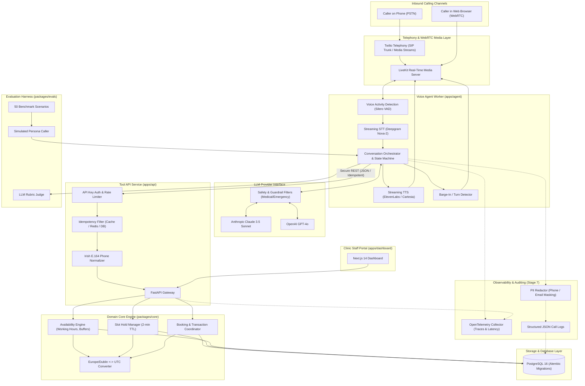
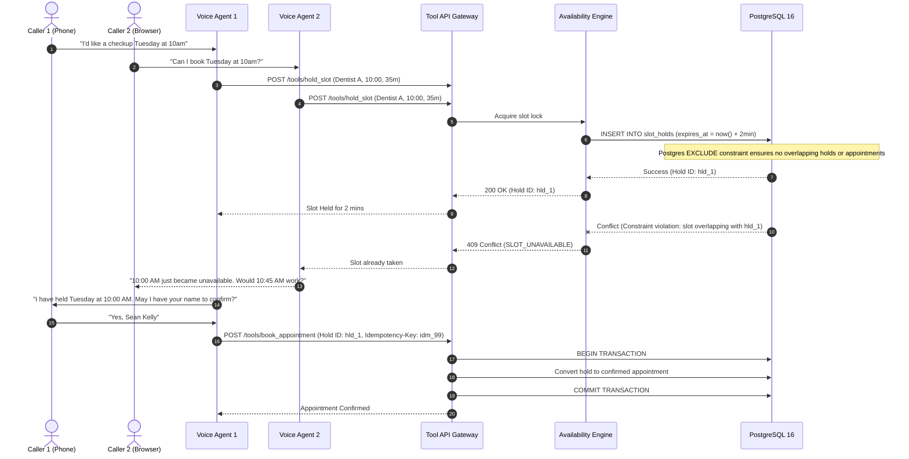

# DentaCall System Architecture

This document describes the architectural design, component interactions, data flow, concurrency models, and security boundaries of **DentaCall**: a production-grade voice appointment agent for dental practices.

---

## 1. High-Level System Architecture Diagram



---

## 2. Component Breakdown & Responsibilities

### 2.1 Apps

- **`apps/api` (FastAPI Tool Service)**
  - Exposes domain capabilities as discrete, validated REST endpoints matching LLM tool call signatures (`find_patient`, `check_availability`, `hold_slot`, `book_appointment`, `reschedule_appointment`, `cancel_appointment`, `get_clinic_info`, `take_message`, `transfer_to_human`).
  - Enforces API key authentication between agent workers and backend services.
  - Generates OpenAPI 3.1 specifications.
  - Enforces idempotency via `Idempotency-Key` headers on mutating requests.
  - Normalizes phone numbers to standard Irish E.164 formats (e.g., `+353871234567`).

- **`apps/agent` (Voice Agent Worker)**
  - Runs as an asynchronous LiveKit Agents Python worker process.
  - Subscribes to inbound audio tracks and runs streaming VAD (Silero) to detect speaker pauses and interruptions (barge-in).
  - Streams transcribed speech chunks from Deepgram Nova-2 into the conversational state machine.
  - Executes tool calling loops with timeouts and conversational filler phrases (e.g. *"Checking the schedule for you now..."*) to avoid dead air.
  - Streams LLM response tokens directly to text-to-speech (Cartesia / ElevenLabs) with minimal Time-To-First-Audio (TTFA).

- **`apps/dashboard` (Next.js Application)**
  - Interactive management interface for receptionists and clinic partners.
  - Visual calendar displaying confirmed bookings, held slots, and doctor rosters.
  - Call log explorer with turn-by-turn transcripts, tool invocation records, audio recordings, and token cost metrics.
  - WebRTC browser calling widget allowing instant testing of agent flows.

### 2.2 Packages

- **`packages/core` (Domain Logic & Availability Engine)**
  - Shared domain models: `Clinic`, `Dentist`, `Service`, `WorkingHours`, `TimeOff`, `Patient`, `Appointment`, `SlotHold`, `CallLog`.
  - Canonical time representation: All timestamps stored in **UTC**; converted to **Europe/Dublin** (handling Irish Standard Time vs. GMT daylight saving transitions) only when presenting or calculating clinic slots.
  - Availability algorithm: Computes free time windows considering:
    - Dentist working hours
    - Daily lunch break (13:00 – 14:00)
    - Irish statutory bank holidays
    - Planned doctor time off / sick leave
    - Service duration + cleaning buffer
    - Existing confirmed appointments & active slot holds
  - Slot hold system: Ephemeral 2-minute reservation holds to prevent race conditions during caller confirmation dialogue.

- **`packages/evals` (Testing & Quality Assurance Suite)**
  - 50 diverse test scenarios covering routine bookings, date ambiguities, accent variations, emergency triages, prompt injection attacks, and cancellations.
  - Simulated caller LLM with goal state and persona.
  - Automated rubric-based judge measuring task completion, tool call validity, guardrail adherence, and conversational latency.

---

## 3. Concurrency Control & Double-Booking Prevention

Preventing double-booking under concurrent phone calls is a critical safety requirement. DentaCall enforces a multi-layered defense strategy:



### Concurrency Mechanisms:
1. **PostgreSQL GiST Overlap Exclusion Constraint:**
   ```sql
   ALTER TABLE appointments ADD CONSTRAINT no_dentist_appointment_overlap
   EXCLUDE USING gist (
       dentist_id WITH =,
       tsrange(start_time_utc, end_time_utc, '[)') WITH &&
   ) WHERE (status != 'cancelled');
   ```
2. **Ephemeral Slot Holds (2-minute TTL):**
   Active holds prevent other callers from selecting the slot while the first caller spells their name and details.
3. **Idempotency Keys:**
   Every mutating request carries an `Idempotency-Key` UUID. Retrying a failed voice network request returns the cached result without creating duplicate records.

---

## 4. Latency Budget & Audio Pipeline Optimization

For a voice receptionist to feel responsive and natural, end-to-end turn latency (Time-to-First-Audio) must remain below **1.2 seconds**.

| Stage | Component | Target Latency | Optimization Strategy |
| :--- | :--- | :--- | :--- |
| **Voice Activity Detection** | Silero VAD | < 80 ms | Run locally in-memory; low-threshold pause detection (450ms). |
| **Speech-to-Text (STT)** | Deepgram Nova-2 | < 250 ms | Websocket streaming, interim transcripts, customized dental vocabulary keyterms. |
| **Agent / LLM TTFT** | Claude 3.5 / GPT-4o | < 400 ms | Stream tokens; prioritize concise 1-2 sentence replies; prompt caching. |
| **Conversational Fillers** | Agent Worker | < 50 ms | Play filler audio (*"Let me check that..."*) immediately when tool call is initiated. |
| **Tool Execution** | FastAPI + DB | < 120 ms | Indexed queries, local database connection pooling, async I/O. |
| **Text-to-Speech (TTS)** | Cartesia / ElevenLabs | < 250 ms | Streaming chunked generation; sentence-boundary chunking. |
| **Network & WebRTC** | LiveKit SFU | < 50 ms | Edge media routing, WebRTC OPUS codec. |
| **Total Round-Trip** | **End-to-End** | **< 1,150 ms** | **Within 1.2s SLA** |

---

## 5. Security, Privacy, and Data Governance

1. **Authentication & Authorization:**
   - Agent-to-API communication is protected by internal bearer tokens (`X-API-Key`).
   - Dashboard endpoints use secure session cookies.
2. **PII Masking & Redaction:**
   - In accordance with Irish and European GDPR standards, phone numbers and email addresses are masked in stored logs and telemetry traces (`+353 87 *** *123`).
   - Raw audio recordings can be toggled off or subjected to an automated data retention cleanup job (`DATA_RETENTION_DAYS=90`).
3. **Emergency Escalation Bypass:**
   - When emergency symptoms are flagged (severe swelling, uncontrollable bleeding, avulsed tooth), all routine state machines are suspended, and the call is immediately transferred or directed to emergency services (999/112).
