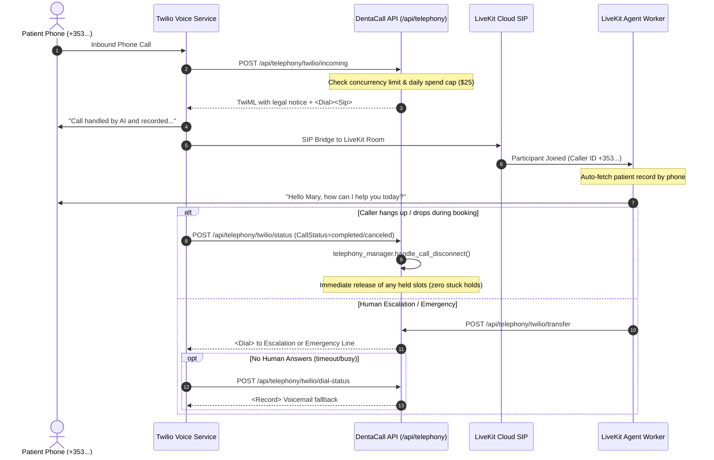

# DentaCall Telephony & Twilio Integration Guide (Stage 6)

## 1. Architecture Overview

DentaCall supports real telephone calls to the Grand Canal Dental Clinic AI receptionist via Twilio Programmable Voice and LiveKit SIP Trunking.



---

## 2. Telephony Features

### 2.1 Inbound Caller ID & Patient Auto-Identification
- When a phone call arrives, the caller's E.164 phone number is extracted from the Twilio `From` field or LiveKit `participant.identity` / `sip.phoneNumber` attribute.
- The receptionist worker calls `find_patient(phone=caller_phone)` in the background.
- If recognized, the agent greets the caller by their first name (e.g. *"Hello Mary, thank you for calling Grand Canal Dental Clinic..."*).

### 2.2 Mandatory Legal Notice & Disclosure
- Before any conversational audio or booking flow begins, the caller hears the legally required Irish healthcare disclaimer:
  > *"Thank you for calling Grand Canal Dental Clinic. Please note that this call is handled by an AI receptionist and may be recorded for quality and training purposes."*

### 2.3 Dropped Call Recovery & Zero Stuck Holds Invariant
- During booking, slots are temporarily locked using a 2-minute slot hold (`hold_slot`).
- If a caller hangs up, disconnects, or experiences mobile signal loss prior to explicit booking confirmation:
  1. The disconnect event triggers `telephony_manager.handle_call_disconnect(call_id)`.
  2. Any active, unconfirmed slot holds registered to that call session are immediately released (`SlotHoldStatus.RELEASED`).
  3. The slot instantly returns to available clinic inventory.
  4. The call is logged as `DROPPED` with the exact duration and holds released.

### 2.4 Human Handoff & Voicemail Fallback
- **Regular Escalation:** Calls needing human reception staff are transferred to `CLINIC_ESCALATION_NUMBER` (`+35312345679`).
- **Emergency Triage:** Acute clinical emergencies (uncontrolled bleeding, severe facial swelling) route directly to `EMERGENCY_TRANSFER_NUMBER` (`+35312349999`).
- **Voicemail Fallback:** If the human line is busy, unanswered after 20 seconds, or after-hours, the call transitions automatically to `<Record>` voicemail mode. The recording URL and caller details are logged for receptionist follow-up.

### 2.5 Concurrency Limits & Daily Spend Cap
- **Concurrency Limit:** Defaults to `MAX_CONCURRENT_CALLS=10`. New calls exceeding capacity receive a polite busy notice and instructions to hold or call back.
- **Daily Spend Cap:** Defaults to `DAILY_SPEND_CAP_USD=25.0` per Dublin calendar day. Protects practice owners from runaway telephony or LLM token costs. Once reached, non-emergency callers receive a friendly quota announcement redirecting them to the website.

---

## 3. Configuration & Webhook Setup

### 3.1 Environment Variables (`.env`)
```bash
# Telephony Configuration
TWILIO_ACCOUNT_SID=ACXXXXXXXXXXXXXXXXXXXXXXXXXXXXXXXX
TWILIO_AUTH_TOKEN=your_twilio_auth_token_here
TWILIO_PHONE_NUMBER=+35312345678
LIVEKIT_SIP_URI=sip:your-trunk@sip.livekit.cloud
EMERGENCY_TRANSFER_NUMBER=+35312349999
CLINIC_ESCALATION_NUMBER=+35312345679
MAX_CONCURRENT_CALLS=10
DAILY_SPEND_CAP_USD=25.0
CALL_RECORDING_NOTICE_ENABLED=true
```

### 3.2 Twilio Console Webhook URLs
Configure your Twilio Phone Number Voice webhook in the Twilio Console:
- **A CALL COMES IN:** `Webhook` $\rightarrow$ `POST` `https://<your-domain>/api/telephony/twilio/incoming`
- **CALL STATUS CHANGES:** `Webhook` $\rightarrow$ `POST` `https://<your-domain>/api/telephony/twilio/status`
